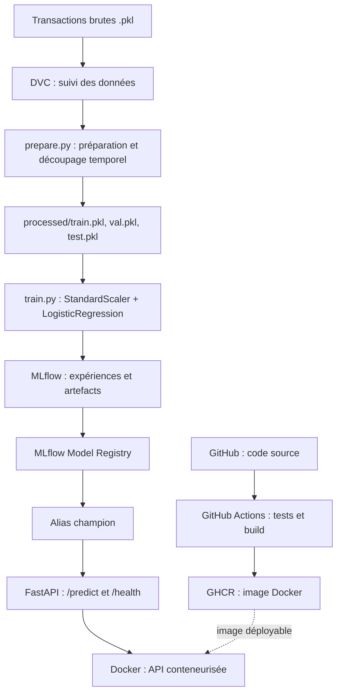

# Détection de fraude transactionnelle — Pipeline MLOps

> Mini-projet d'industrialisation d'un pipeline de Machine Learning classique, de la préparation des données à l'exposition d'une API de prédiction.

## 1. Présentation

Ce projet illustre la mise en place d'une démarche **MLOps** pour la détection de transactions potentiellement frauduleuses. Il associe un modèle de classification supervisée à des outils de **versionnement des données**, de **suivi des expériences**, de **déploiement conteneurisé** et d'**intégration continue**.

**Objectifs :**
- Préparer des transactions et entraîner un modèle de classification reproductible.
- Suivre les expériences et gérer les versions du modèle avec MLflow.
- Exposer les prédictions via une API REST FastAPI.
- Conteneuriser l'application avec Docker et automatiser les tests et la publication de l'image avec GitHub Actions.
- Versionner les données et les dépendances du pipeline avec DVC.

**Technologies :** Python, pandas, scikit-learn, MLflow, DVC, FastAPI, Pydantic, Docker, Git, GitHub Actions et GitHub Container Registry (GHCR).

Le jeu de données utilisé provient de données transactionnelles simulées au format `.pkl`. Il comprend **1 754 155 transactions**, réparties chronologiquement entre entraînement, validation et test.

## 2. Architecture



### Organisation du dépôt

| Fichier / dossier | Rôle |
|---|---|
| `model.ipynb` | Exploration et premiers essais de modélisation |
| `prepare.py` | Lecture des données, création des variables et séparation chronologique |
| `train.py` | Entraînement, évaluation sur validation et journalisation MLflow |
| `app.py` | API FastAPI de prédiction |
| `set_chmapion.py` | Attribution manuelle de l'alias `champion` à une version enregistrée (nom actuel du script) |
| `dvc.yaml` | Définition des étapes `prepare` et `train` |
| `dvc.lock` | Empreintes des dépendances et sorties de la dernière exécution DVC |
| `data.dvc` | Métadonnées de suivi du jeu de données brut |
| `Dockerfile` | Construction de l'image de l'API |
| `.github/workflows/ci.yml` | Pipeline CI de tests et publication de l'image |

### Pipeline d'apprentissage

1. Chargement des fichiers `.pkl` et tri par `TX_DATETIME`.
2. Création des variables `TX_HOUR` et `TX_DAY_OF_WEEK`.
3. Découpage chronologique : **70 % entraînement**, **15 % validation**, **15 % test**.
4. Entraînement d'un pipeline `StandardScaler` + `LogisticRegression(class_weight="balanced")` sur `TX_AMOUNT`, `TX_HOUR` et `TX_DAY_OF_WEEK`.
5. Calcul des métriques sur la validation et enregistrement dans MLflow.

> Le prétraitement de normalisation est intégré au pipeline scikit-learn : il est ajusté uniquement sur les données d'entraînement.

## 3. Installation

### Prérequis

- Python et `pip` (environnement utilisé pendant le développement : Python 3.14).
- Git et DVC.
- Docker Desktop pour exécuter l'API en conteneur.
- Accès à un serveur MLflow (dans ce projet, lancé localement sur le port `5001`).
- Accès aux données DVC : le stockage distant configuré pendant le développement est **un dossier local sur le Mac** ; il n'est pas accessible automatiquement depuis une autre machine.

### Récupérer le projet

```bash
git clone https://github.com/zahismail/fraud-detection-mlops.git
cd fraud-detection-mlops
python3 -m venv .venv
source .venv/bin/activate
```

Installer les dépendances déclarées dans le dépôt, **si un fichier `requirements.txt` est présent** :

```bash
pip install -r requirements.txt
```

Sinon, installer les dépendances nécessaires au pipeline local :

```bash
pip install pandas scikit-learn mlflow dvc joblib fastapi uvicorn pydantic
```

### Données

Le dossier `data/` est suivi par DVC, et non stocké directement dans Git. Sur la machine où le remote DVC est disponible :

```bash
dvc pull
```

Sur une autre machine, il faut d'abord configurer un stockage DVC accessible ou obtenir les données par un canal autorisé. Le simple `git clone` ne suffit pas à télécharger le dataset.

## 4. Exécution

### A. Lancer MLflow

Dans un terminal avec l'environnement activé :

```bash
mlflow server --host 0.0.0.0 --port 5001 \
  --allowed-hosts "localhost:*,127.0.0.1:*,host.docker.internal:*"
```

Interface : **http://127.0.0.1:5001**.

> Dans cette configuration de démonstration, le serveur MLflow tourne sur le Mac, en dehors du conteneur Docker. Conserver sa base de données et ses artefacts pour retrouver les expériences et modèles enregistrés.

### B. Reproduire le pipeline avec DVC

```bash
dvc repro
```

DVC exécute les étapes nécessaires de préparation et d'entraînement, ou les ignore si les dépendances et sorties sont inchangées.

Pour sauvegarder les sorties suivies par DVC vers le stockage configuré :

```bash
dvc push
```

Les métriques de validation sont visibles dans MLflow. L'exécution de `train.py` crée une nouvelle expérience et un modèle journalisé, **sans promouvoir automatiquement** celui-ci dans le registre.

### C. Choisir le modèle servi

Le modèle de production de la démonstration est sélectionné par l'alias MLflow `champion`.

```bash
python set_chmapion.py 1
```

Cette commande associe `champion` à la version enregistrée **1**. Pour une autre version approuvée, remplacer `1` par son numéro. La promotion est **manuelle**, après vérification des performances.

L'API charge le modèle par l'URI :

```text
models:/fraud-detection-model@champion
```

### D. Lancer l'API avec Docker

Construire une image locale :

```bash
docker build -t fraud-detection-api .
```

Exécuter le conteneur sur macOS avec MLflow accessible depuis l'hôte :

```bash
docker run --rm --name fraud-detection-api \
  -p 127.0.0.1:8000:8000 \
  -e MLFLOW_TRACKING_URI=http://host.docker.internal:5001 \
  fraud-detection-api
```

Le serveur MLflow doit être lancé **avant** le conteneur pour que l'API puisse charger le modèle au démarrage.

- Documentation interactive : **http://127.0.0.1:8000/docs**
- Vérification de santé : **http://127.0.0.1:8000/health**
- Prédiction : **POST http://127.0.0.1:8000/predict**

**Remarque :** après changement de l'alias `champion`, redémarrer le conteneur afin de recharger le modèle.

## 5. Démonstration

### Scénario 1 — Prédire une transaction

1. Démarrer MLflow et l'API Docker.
2. Ouvrir **http://127.0.0.1:8000/docs**.
3. Sélectionner **POST `/predict`**, puis **Try it out**.
4. Envoyer une transaction de test :

```json
{
  "TX_AMOUNT": 120.0,
  "TX_HOUR": 14,
  "TX_DAY_OF_WEEK": 2
}
```

5. Observer la réponse JSON réelle de l'API et les logs de latence du conteneur.

> L'exemple ci-dessus est une **entrée** de démonstration ; aucune classe prédite n'est indiquée ici, car elle dépend du modèle effectivement chargé.

### Scénario 2 — Reproductibilité DVC

```bash
dvc repro
```

Sans modification des fichiers suivis, DVC doit ignorer les étapes déjà à jour. Si `train.py` change, l'étape d'entraînement est réexécutée sans refaire inutilement la préparation des données.

### Scénario 3 — Traçabilité MLflow

Ouvrir MLflow, consulter l'expérience `fraud-detection`, comparer les runs et visualiser les versions du modèle `fraud-detection-model` dans **Model Registry**. Vérifier l'alias `champion`.

### Scénario 4 — Intégration continue

Dans GitHub, ouvrir l'onglet **Actions** pour consulter les tests et la construction de l'image Docker. L'image publiée est disponible dans **GitHub Container Registry**, sous réserve du succès du workflow.

### Résultats obtenus

| Indicateur | Validation |
|---|---:|
| Precision | 0,0165 (1,65 %) |
| Recall | 0,4484 (44,84 %) |
| F1-score | 0,0318 (3,18 %) |

Ces valeurs proviennent de l'exécution documentée du pipeline de réentraînement ; elles ne garantissent pas les performances de toutes les versions enregistrées. Le modèle présente de nombreuses fausses alertes et **n'est pas adapté à un usage réel sans améliorations supplémentaires**.

## 6. Limites et perspectives

- La sélection du modèle `champion` est manuelle ; aucune promotion automatique n'est implémentée.
- Le suivi actuel de la latence ne constitue pas une supervision complète (pas de détection automatique de dérive).
- Le stockage DVC est local et nécessite une configuration supplémentaire pour une collaboration distante.
- Le serveur MLflow local doit rester accessible lors du démarrage de l'API.
- Les performances du modèle sont modestes : le projet vise d'abord la **démonstration de l'industrialisation MLOps**.

**Améliorations possibles :** évaluation comparative automatisée, critères de promotion, stockage partagé, tests de dérive et déploiement sur une infrastructure distante.

---

**Dépôt GitHub :** https://github.com/zahismail/fraud-detection-mlops
