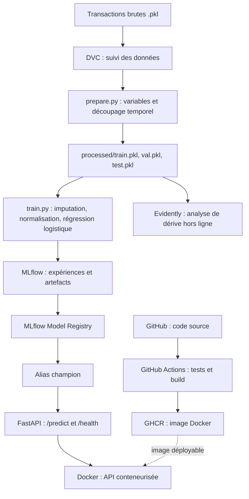

# Détection de fraude transactionnelle — Pipeline MLOps

> Mini-projet d'industrialisation d'un pipeline de Machine Learning, de la préparation des données à l'exposition d'une API de prédiction.

## 1. Présentation

Ce projet illustre une démarche **MLOps** appliquée à la détection de transactions potentiellement frauduleuses. Il associe un modèle de classification supervisée au **versionnement des données**, au **suivi des expériences**, au **déploiement conteneurisé**, à l'**intégration continue** et à une analyse de dérive des données.

**Objectifs :**

- Préparer les transactions et entraîner un modèle de manière reproductible.
- Suivre les expériences et gérer les versions du modèle avec MLflow.
- Exposer les prédictions via une API REST FastAPI.
- Conteneuriser l'application avec Docker et automatiser les tests et la publication de l'image avec GitHub Actions.
- Versionner les données et les dépendances du pipeline avec DVC.
- Étudier la dérive des variables avec Evidently, à partir de rapports générés hors ligne.

**Technologies :** Python, pandas, scikit-learn, MLflow, DVC, FastAPI, Pydantic, Docker, Git, GitHub Actions, GitHub Container Registry (GHCR) et Evidently.

Le jeu de données provient de transactions simulées au format `.pkl`. Il comprend **1 754 155 transactions**, dont environ **0,84 % de fraudes**.

## 2. Architecture



### Organisation du dépôt

| Fichier / dossier | Rôle |
|---|---|
| `model.ipynb` | Exploration et premiers essais de modélisation |
| `prepare.py` | Lecture des données, création des variables et séparation chronologique |
| `train.py` | Entraînement, évaluation sur validation et journalisation MLflow |
| `app.py` | API FastAPI de prédiction |
| `set_chmapion.py` | Attribution manuelle de l'alias `champion` (orthographe actuelle du script) |
| `dvc.yaml` | Définition des étapes `prepare` et `train` |
| `dvc.lock` | Empreintes des dépendances et sorties de la dernière exécution DVC |
| `data.dvc` | Métadonnées de suivi du jeu de données brut |
| `Dockerfile` | Construction de l'image de l'API |
| `.github/workflows/ci.yml` | Pipeline CI de tests et publication de l'image |
| `monitoring/` | Rapports de dérive, lorsqu'ils ont été générés |

### Pipeline d'apprentissage

1. Chargement des fichiers `.pkl` et tri chronologique par `TX_DATETIME`.
2. Création des variables temporelles `TX_HOUR` et `TX_DAY_OF_WEEK`.
3. Création de variables de comportement client à partir des transactions antérieures : `CUSTOMER_AVG_AMOUNT`, `CUSTOMER_TX_COUNT` et `AMOUNT_TO_AVG_RATIO`.
4. Découpage chronologique : **70 % entraînement**, **15 % validation**, **15 % test**.
5. Entraînement d'un pipeline `SimpleImputer(strategy="median")` → `StandardScaler` → `LogisticRegression(class_weight="balanced", max_iter=1000)`.
6. Calcul des métriques sur la validation avec un **seuil de classification de 0,82**, puis journalisation dans MLflow.

Les **six variables d'entrée** sont :

```text
TX_AMOUNT
TX_HOUR
TX_DAY_OF_WEEK
CUSTOMER_AVG_AMOUNT
CUSTOMER_TX_COUNT
AMOUNT_TO_AVG_RATIO
```

L'imputation et la normalisation sont ajustées uniquement sur les données d'entraînement. Les variables historiques doivent être calculées sans utiliser d'informations futures ; leur cohérence avec le traitement des transactions en production reste à vérifier.

**Important :** le seuil `0.82` est appliqué explicitement aux probabilités retournées par `predict_proba()`. Il n'est pas intégré automatiquement à `pipeline.predict()`.

## 3. Installation

### Prérequis

- Python et `pip` (environnement de développement utilisé : Python 3.14).
- Git et DVC.
- Docker Desktop pour exécuter l'API en conteneur.
- Un serveur MLflow local, sur le port `5001`.
- Accès aux données DVC : le remote configuré pendant le développement est **un dossier local sur la machine de développement**, non accessible automatiquement depuis une autre machine.

### Récupérer le projet

```bash
git clone https://github.com/zahismail/fraud-detection-mlops.git
cd fraud-detection-mlops
python3 -m venv .venv
source .venv/bin/activate
```

Si le dépôt contient un fichier `requirements.txt` :

```bash
pip install -r requirements.txt
```

Sinon, pour installer les principales dépendances du pipeline local :

```bash
pip install pandas scikit-learn mlflow dvc joblib fastapi uvicorn pydantic evidently
```

Pour une reproduction stricte, utiliser les versions des dépendances validées avec le projet.

### Données

Le dossier `data/` est suivi par DVC, et non stocké directement dans Git. Sur la machine où le remote DVC est accessible :

```bash
dvc pull
```

Sur une autre machine, il faut d'abord configurer un stockage DVC accessible ou obtenir les données par un canal autorisé. Un simple `git clone` ne télécharge pas le dataset.

## 4. Exécution

### A. Lancer MLflow

Depuis la racine du projet, dans un terminal avec l'environnement activé :

```bash
mlflow server \
  --backend-store-uri sqlite:///mlflow.db \
  --host 0.0.0.0 \
  --port 5001 \
  --allowed-hosts "localhost:*,127.0.0.1:*,host.docker.internal:*"
```

**Interface MLflow :** http://127.0.0.1:5001

Le nom d'hôte `host.docker.internal` est utilisé par le conteneur Docker pour joindre MLflow sur le Mac. L'option `--allowed-hosts` évite le refus HTTP `403 Invalid Host header` lorsque ce nom est utilisé.

> **Sécurité :** cette configuration est destinée au développement local. `--host 0.0.0.0` écoute sur toutes les interfaces réseau : ne pas exposer ce serveur à un réseau non fiable sans protections supplémentaires. Lancer MLflow depuis le bon répertoire permet de retrouver la base `mlflow.db` attendue.

### B. Reproduire le pipeline avec DVC

```bash
dvc repro
```

DVC exécute les étapes nécessaires de préparation et d'entraînement, ou les ignore si leurs dépendances et sorties sont inchangées.

Pour envoyer les sorties suivies vers le stockage DVC configuré :

```bash
dvc push
```

Les métriques de validation sont visibles dans MLflow. `train.py` journalise un modèle et ses métriques, **sans promouvoir automatiquement** une nouvelle version dans le registre.

### C. Choisir le modèle servi

L'API charge la version enregistrée sous l'alias MLflow `champion` :

```text
models:/fraud-detection-model@champion
```

Après avoir enregistré et vérifié une version du modèle dans **MLflow Model Registry**, attribuer l'alias à son numéro de version approuvé :

```bash
python set_chmapion.py <numero_de_version>
```

Par exemple, remplacer `<numero_de_version>` par le numéro affiché dans le registre. **Ne pas conserver automatiquement la version 1** : elle peut correspondre à l'ancien modèle à trois variables.

Avant de lancer l'API mise à jour, vérifier que `champion` pointe vers un modèle entraîné avec les **six variables**. Changer l'alias nécessite de redémarrer l'API pour recharger le modèle.

### D. Construire et lancer l'API avec Docker

**1.** Vérifier que MLflow est démarré (section A) et que l'alias `champion` est correct (section C).

**2.** Construire l'image après toute modification de `app.py`, du `Dockerfile` ou des dépendances intégrées :

```bash
docker build -t fraud-detection-api .
```

**3.** Lancer le conteneur sur macOS :

```bash
docker run --rm --name fraud-detection-api \
  -p 127.0.0.1:8000:8000 \
  -e MLFLOW_TRACKING_URI=http://host.docker.internal:5001 \
  fraud-detection-api
```

L'API charge le modèle `champion` au démarrage. MLflow doit donc être accessible **avant** le lancement du conteneur.

- Documentation interactive : http://127.0.0.1:8000/docs
- Vérification de santé : http://127.0.0.1:8000/health
- Prédiction : **POST** http://127.0.0.1:8000/predict

## 5. Démonstration

### Scénario 1 — Prédire une transaction

1. Démarrer MLflow, vérifier `champion`, puis lancer l'API Docker.
2. Ouvrir http://127.0.0.1:8000/docs.
3. Sélectionner **POST `/predict`**, puis **Try it out**.
4. Envoyer cet exemple de transaction :

```json
{
  "TX_AMOUNT": 500,
  "TX_HOUR": 23,
  "TX_DAY_OF_WEEK": 5,
  "CUSTOMER_AVG_AMOUNT": 50,
  "CUSTOMER_TX_COUNT": 12,
  "AMOUNT_TO_AVG_RATIO": 10
}
```

5. Observer la réponse JSON de l'API et les logs de latence du conteneur.

Si `app.py` correspond à la version mise à jour, la réponse comporte `is_fraud` (`0` ou `1`) et `fraud_probability` (probabilité estimée). La classification utilise le seuil **0,82**.

> Ces valeurs sont fictives. Elles servent uniquement à tester l'API et ne garantissent pas une classe prédite particulière. Dans cette démonstration, les variables historiques sont fournies dans la requête ; une application réelle devrait les calculer à partir de l'historique client de manière cohérente avec l'entraînement.

### Scénario 2 — Reproductibilité DVC

```bash
dvc repro
```

Sans modification des fichiers suivis, DVC ignore les étapes déjà à jour. Si `train.py` change, l'entraînement est réexécuté sans refaire inutilement la préparation des données.

### Scénario 3 — Traçabilité MLflow

Dans l'expérience `fraud-detection`, consulter les runs et comparer les métriques. Dans **Model Registry**, examiner les versions de `fraud-detection-model` et vérifier l'alias `champion`.

### Scénario 4 — Intégration continue

Dans GitHub, ouvrir l'onglet **Actions** pour consulter les tests et la construction de l'image Docker. L'image publiée est disponible dans **GitHub Container Registry**, sous réserve du succès du workflow.

### Scénario 5 — Analyse de dérive avec Evidently

Consulter les rapports HTML générés dans `monitoring/` : comparaison de référence et simulation d'une dérive de `TX_AMOUNT`. Il s'agit d'une **analyse hors ligne**, pas d'un système de surveillance continue en production.

### Résultats obtenus

Résultats du modèle à six variables sur le **jeu de validation** :

| Indicateur | Seuil 0,50 | Seuil 0,82 |
|---|---:|---:|
| Precision | 1,45 % | **76,64 %** |
| Recall | **57,32 %** | 28,70 % |
| F1-score | 2,84 % | **41,77 %** |

Le seuil **0,82** donne le meilleur F1-score parmi les seuils testés. Cependant, il réduit sensiblement le recall : le modèle détecte moins de fraudes qu'au seuil 0,50. Le choix du seuil dépend donc du coût des fausses alertes et des fraudes manquées.

**Ces chiffres proviennent de la validation, utilisée pour sélectionner le seuil.** Il faut encore évaluer le modèle et le seuil retenu sur le **jeu de test** avant de considérer ces performances comme confirmées.

## 6. Limites et perspectives

- La promotion du modèle `champion` est manuelle ; aucune promotion automatique n'est implémentée.
- L'API de démonstration reçoit les variables historiques dans la requête : leur calcul automatique à partir des transactions précédentes reste à industrialiser.
- Le seuil `0,82` améliore la précision et le F1-score sur la validation, mais réduit le recall.
- La vérification finale sur le jeu de test et l'audit des risques de fuite de données des variables historiques restent nécessaires.
- La mesure de latence et les rapports Evidently hors ligne ne constituent pas une supervision continue complète.
- Le stockage DVC est local et nécessite une configuration supplémentaire pour une collaboration distante.
- Le serveur MLflow local doit rester accessible lors du démarrage de l'API.

**Améliorations possibles :** évaluation sur test, choix du seuil fondé sur les coûts métier, calcul des variables historiques dans l'API, suivi de dérive automatisé, critères de promotion et stockage partagé.

---

**Dépôt GitHub :** https://github.com/zahismail/fraud-detection-mlops
